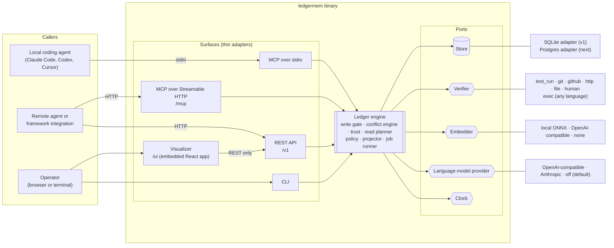
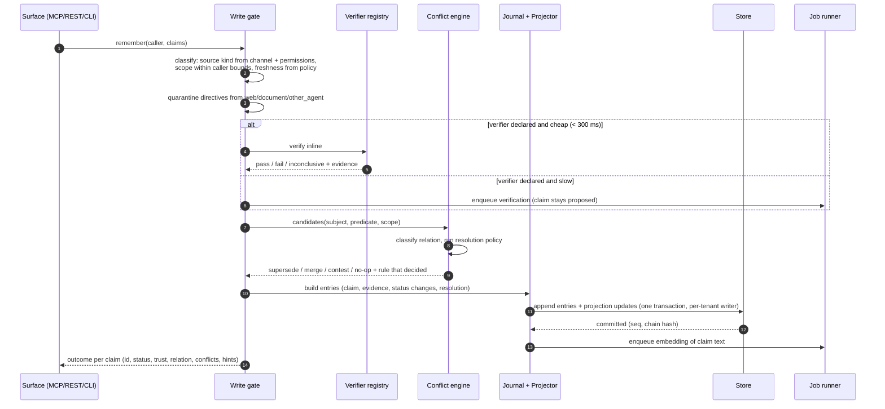
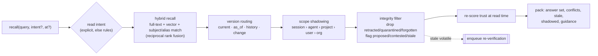

# Ledger architecture

How Ledger v1 is put together: one deep module (the **Ledger engine**) behind a small interface, a few ports where something really varies, and thin surfaces (MCP, REST, CLI, visualizer) that only translate. Domain terms follow [GLOSSARY.md](../../GLOSSARY.md); design vocabulary (module, interface, seam, adapter, depth) follows the codebase-design discipline. Decisions referenced as ADR-NNNN live in [docs/adr/](../adr/).

Companion documents:

- [claims-and-integrity.md](claims-and-integrity.md): the rules the engine enforces (lifecycle, relations, resolution, trust, freshness, read routing, journal hashing).
- [contracts.md](contracts.md): everything outside the binary depends on: MCP tools, REST, CLI, config, policy file, exec verifier protocol, backup format.

## Shape at a glance



Everything that decides what is true lives in the engine. Every surface behaves identically because none of them contain integrity logic; deleting a surface deletes only translation code.

## The Ledger engine (the deep module)

### Interface

The engine is one value, constructed once with its adapters, and called with a **Caller** on every operation. The interface has three groups. The first mirrors the seven MCP tools one-to-one.

```rust
// Sketch of the interface, not final signatures.
impl Ledger {
    // Memory operations: what agents use.
    async fn remember(&self, caller: &Caller, req: Remember) -> Result<RememberOutcome>;
    async fn attest(&self, caller: &Caller, req: Attest) -> Result<AttestOutcome>;
    async fn recall(&self, caller: &Caller, req: Recall) -> Result<ReadPack>;
    async fn check_before_act(&self, caller: &Caller, req: PlannedAction) -> Result<ActionVerdict>;
    async fn history(&self, caller: &Caller, req: HistoryQuery) -> Result<VersionChain>;
    async fn resolve(&self, caller: &Caller, req: Resolve) -> Result<ResolveOutcome>; // settle a conflict set, or retract a claim
    async fn forget(&self, caller: &Caller, req: Forget) -> Result<ForgetOutcome>;

    // Review operations: what operators use (visualizer, CLI).
    async fn browse(&self, caller: &Caller, q: Browse) -> Result<Page<ReviewItem>>; // claims, conflicts, questions, journal, undeclared predicates
    async fn claim(&self, caller: &Caller, id: ClaimId) -> Result<ClaimDetail>;      // trust breakdown, evidence, chain, entries
    async fn answer(&self, caller: &Caller, req: Answer) -> Result<AnswerOutcome>;  // open questions, human confirmations
    async fn apply_policy(&self, caller: &Caller, req: ApplyPolicy) -> Result<PolicyVersion>;

    // Administration.
    async fn backup(&self, caller: &Caller, sink: impl AsyncWrite) -> Result<BackupManifest>;
    async fn restore(&self, caller: &Caller, source: impl AsyncRead) -> Result<RestoreReport>;
    async fn verify_journals(&self, caller: &Caller) -> Result<ChainReport>;
    async fn admin(&self, caller: &Caller, req: AdminRequest) -> Result<AdminOutcome>; // tenants and keys
}
```

A correction is not a separate operation. It is `remember` called through the visualizer or CLI channel with `supersedes` set, which the engine records as a user-stated claim with human-confirmation evidence (ADR-0003, ADR-0009).

**Caller** carries everything the engine needs to know about who is asking. Surfaces build it from the API key or the stdio launch arguments; the model never supplies it.

| Field | Meaning |
| --- | --- |
| tenant | The one tenant this caller may touch. |
| actor | Who is acting (`agent:claude-code`, `operator:samaksh`, `integration:langgraph`). |
| channel | agent, integration, visualizer, cli, elicitation (see ADR-0009). |
| permissions | Some of: read, propose, attest, resolve, forget, relay_user, operator, admin. |
| scope bounds | The widest scopes the caller may read and write (org; user id; project id; agent id). Calls may only narrow these, for example to a session. |

**Invariants the interface promises:**

- Every write is committed to a journal before it is visible to any read. A write either commits all of its entries or none.
- Reads never mutate memory. The only side effect a read can have is enqueuing a background re-verification.
- No operation returns or touches data from another tenant. A request that names a scope outside the caller's bounds fails with `ScopeDenied`. It is never filtered silently.
- The same journal plus the same policy versions always produce the same projections (ADR-0010).
- `recall` never waits on a verifier. `check_before_act` waits for at most its re-verification budget (2 s by default) and answers `re-verify` if the budget runs out.

**Error modes** are a closed set that every surface maps to its own conventions: `ScopeDenied`, `PermissionDenied`, `NotFound`, `InvalidClaim` (with field errors), `ChainBroken` (reindex and restore refuse a journal that doesn't verify; `verify` itself reports, never fails), `RestoreTargetNotEmpty`, `Busy` (writes kept the operation from finishing, such as reindex after three interrupted attempts), `VerifierUnavailable`, `Internal`.

### What the engine hides

| Internal module | Responsibility |
| --- | --- |
| Write gate | Runs the six steps for every claim: intake → classification (source kind from channel and permissions, scope, freshness class) → verification (inline when cheap, otherwise queued) → conflict check → scoring → commit. No extraction step in v1 (ADR-0002). |
| Conflict engine | Generates candidates by subject and predicate within one scope, classifies the relation with fixed rules, and runs the resolution policy in order. |
| Trust scorer | Computes the trust score and its explainable components. Runs at write time for gate decisions and again at read time. |
| Read planner | Read intent → hybrid recall → version routing → scope shadowing → integrity filter → packing. |
| Policy | Parses, validates and versions policy documents, applies predicate packs and overlays, and resolves aliases. |
| Projector | Turns journal entries into projection updates (claims, chains, conflict sets, questions, the recall index). It is used both for live writes and for `reindex` and restore. |
| Journal | Builds entries, computes content hashes and chain hashes, and verifies chains. |
| Job runner | Durable queued jobs: async verification, stale re-verification, embedding, index purge after a forget. |
| Guard | `check_before_act`: gathers the claims the action relies on, re-verifies within budget, and decides go, re-verify or block. |

These modules have **internal seams** that their own unit tests may use (the relation classifier and trust scorer are pure functions, for example). None of them is part of the engine's interface.

### Write path



Writes for one tenant go through a single writer task, so journal sequence numbers and chain hashes are assigned without races. SQLite allows only one writer anyway, and per-tenant serialization keeps the same guarantee on Postgres. Reads run concurrently.

### Read path



## Ports and adapters

A port exists only where at least two adapters are real. Each port is classified by the dependency categories in the codebase-design deepening guide, which decides how it is tested.

| Port | Adapters | Dependency category | Test strategy |
| --- | --- | --- | --- |
| Store | SQLite (v1), Postgres + pgvector (next milestone) | Local-substitutable | Engine tests run on in-memory SQLite, the shipping adapter. A shared store conformance suite runs against every adapter. |
| Verifier | test_run, git, github, http, file, human, exec, llm_judge; **scripted** (tests) | Mixed: local (git, file, test_run, exec), true external (github, http to third parties) | Engine tests use the scripted verifier. Each built-in is tested against real local stand-ins (a temporary repo, a loopback HTTP server, JUnit fixtures). GitHub uses recorded responses. |
| Embedder | local ONNX (fastembed, default), OpenAI-compatible HTTP, none; **deterministic hash** (tests) | Local / true external | Engine tests use the deterministic embedder so recall ranking is reproducible. |
| Language-model provider | OpenAI-compatible, Anthropic; **scripted** (tests) | True external | Optional and off by default. Only the llm_judge verifier and future free-text extraction use it. |
| Clock | system clock; **test clock** | In-process | Every time-dependent rule (staleness, valid time, as_of reads) is tested by moving the test clock. Nothing in the engine reads the wall clock directly. |

The store port is deliberately **not** a generic key-value or SQL interface. It speaks in the engine's terms (append entries with projection updates, fetch candidates by claim key, hybrid search, read a chain, page a journal, queue jobs), so the Postgres adapter re-implements those terms rather than an ORM. No SQL appears above the store port (ADR-0001).

## Surfaces

Surfaces are adapters at the engine's seam. Each does exactly three things: authenticate and build a Caller, translate the request into an engine call, and translate the result or error back. None is allowed to branch on claim content.

| Surface | Transport | Caller comes from |
| --- | --- | --- |
| `ledgermem mcp` | stdio (default) | Launch arguments: `--tenant` (optional, default `local`), `--user`, `--project`, `--agent`. Channel `agent`, with `relay_user` granted by default (ADR-0009). |
| `ledgermem mcp --transport http` | Streamable HTTP, stateless per the MCP 2026-07-28 spec | API key in `Authorization: Bearer`. The key binds tenant, scope bounds and permissions. `--tenant` pins a single-tenant server. |
| `ledgermem serve` | HTTP: REST at `/v1`, MCP at `/mcp`, visualizer at `/ui` | API key. The visualizer uses an operator key and binds to localhost by default. |
| CLI subcommands | in-process | The local operator on that machine, with channel `cli` (`ledgermem policy apply`, `backup`, `restore`, `questions`, `reindex`, `verify`, `tenant`, `key`). |

The MCP surface uses `rmcp` (the official Rust SDK), which implements the 2026-07-28 stateless specification, Streamable HTTP and the Tasks extension. Slow verification inside `memory_remember` and `memory_attest` becomes an MCP task when the client announces Tasks support. Otherwise the call returns at once with the claim `proposed` and verification pending.

## Workspace layout

```
Cargo.toml                    workspace
crates/
  ledgermem-core/             engine, domain types, ports (no database, HTTP or model dependencies)
  ledgermem-sqlite/           Store adapter: SQLite, FTS5 full-text, vector search
  ledgermem-verifiers/        built-in verifiers and the exec protocol runner
  ledgermem-models/           embedders and language-model providers (feature-gated)
  ledgermem-server/           REST (axum + OpenAPI), MCP (rmcp), auth, embedded visualizer assets
  ledgermem/                  the binary: CLI, config loading, wiring adapters into the engine
  ledgermem-scenarios/        integrity scenario suite and seed data (not published)
web/                          the visualizer (React + TypeScript + Vite), built into ledgermem-server
policies/                     predicate packs: software-delivery.yaml, personal-assistant.yaml
docs/
  adr/                        decisions
  design/                     this document and its companions
.scratch/                     specs and tickets (local issue tracker)
```

Crate boundaries enforce the seams at compile time. `ledgermem-core` cannot import SQLite, axum, rmcp or an HTTP client, so integrity logic cannot leak into a surface or an adapter.

| Crate | Depends on | Notable libraries |
| --- | --- | --- |
| ledgermem-core | none of the others | serde, serde_json, serde_jcs (RFC 8785), sha2, time, ulid, thiserror |
| ledgermem-sqlite | core | rusqlite (bundled, FTS5) |
| ledgermem-verifiers | core | gix, reqwest, quick-xml, tokio process |
| ledgermem-models | core | fastembed (feature `local-embeddings`, default on), reqwest |
| ledgermem-server | core | axum, utoipa, rmcp, rust-embed, argon2 |
| ledgermem | all | clap, toml, tracing |
| ledgermem-scenarios | core, sqlite | serde_yaml |

Vector search on SQLite starts as an in-process cosine scan over stored embeddings, which is fast enough for a local tenant's claim count. This is an internal seam of the SQLite adapter, so it can switch to sqlite-vec (currently alpha) or an ANN index without touching the engine.

## Storage model (SQLite adapter)

The journal is the source of truth and every other table is a projection (ADR-0010).

| Table | Kind | Holds |
| --- | --- | --- |
| `entries` | truth | Every journal entry: scope key, sequence, kind, content hash, previous hash, chain hash, actor, channel, recorded time, policy version, and the content (nullable once forgotten). |
| `evidence_blobs` | truth | Evidence metadata and, where small, the observed payload, keyed by content hash. |
| `policy_versions` | truth | Each applied policy document, keyed by version. |
| `tenants`, `keys` | truth | Tenants and hashed API keys with permissions and scope bounds. Kept outside the journal, because they are credentials rather than memory. |
| `claims` | projection | Current state of every claim: key, value, status, valid time, trust components, freshness, supersession links. |
| `conflict_sets`, `questions` | projection | Open and closed conflict sets and open questions. |
| `claims_fts` | projection | FTS5 index over claim text, subject and aliases. |
| `claim_vectors` | projection | Embeddings of claim text. |
| `jobs` | operational | The durable job queue. |

`ledgermem reindex` drops every projection and replays the journal. Restore is the same replay into an empty tenant, after verifying each chain.

## Configuration

Two documents with different owners, kept apart on purpose:

- **Server config** (`ledgermem.toml`, environment overrides): database path, listen address, embedder and model-provider choice, verifier instances and their **credentials** (GitHub token, HTTP endpoint base URLs, exec verifier commands). It is owned by whoever runs the binary and never journaled, because it holds secrets.
- **Policy** (YAML, applied with `ledgermem policy apply`): predicates, aliases and resolution rules. It references verifiers by name and holds no secrets. Every applied version is a journal entry, and each resolution records the version it used.

Formats for both are in [contracts.md](contracts.md).

## Security posture (v1)

- Tenant isolation is enforced in the engine on every operation, not in prompts or surfaces.
- API keys are random 32-byte tokens shown once and stored as argon2 hashes. Permissions are separate, so a proposer key can write `proposed` claims but cannot attest, resolve or forget.
- Source kind is derived, never supplied (ADR-0009). Directives from web, document or other-agent sources are quarantined.
- `ledgermem serve` binds to `127.0.0.1` by default. Binding elsewhere requires an explicit flag and logs a warning when no TLS terminator is configured.
- Exec verifiers run without a shell, with a timeout and an environment allow-list, but are **not sandboxed** in v1 (ADR-0006).
- Per-scope encryption at rest and PII redaction are out of scope for v1. Forget is in scope.

## Performance targets (p95, local SQLite, 100k claims per tenant)

| Operation | Target |
| --- | --- |
| `recall` without re-verification | 150 ms |
| `remember` acknowledgement, async verification | 200 ms |
| inline verifier | 300 ms |
| `check_before_act` | 2 s re-verification budget |
| `reindex` | 100k entries per minute |

The scenario suite includes a load scenario that records these numbers in CI, so regressions are visible.
