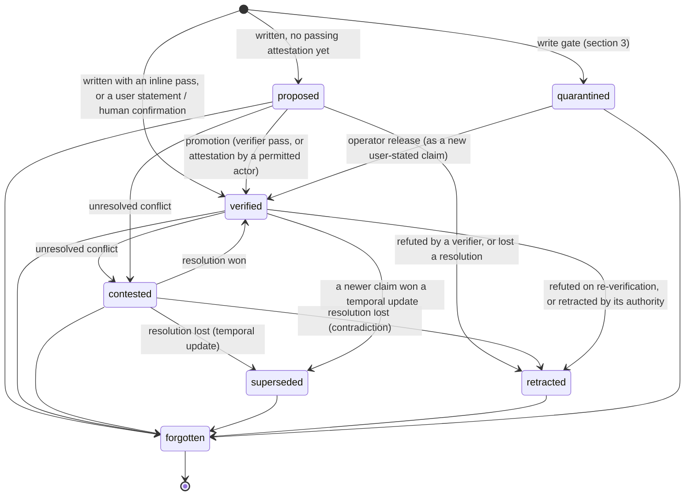

# Claims and integrity rules

The rules the Ledger engine enforces. Everything here is deterministic: given the same journal, policy version and clock, the engine reaches the same decision (ADR-0010). Terms follow [GLOSSARY.md](../../GLOSSARY.md). Numbers marked *default* are policy-configurable.

## 1. The claim

```json
{
  "id": "clm_01JB7Q4R2V8M6N0P3S5T7W9X1Y",
  "scope": { "tenant": "acme", "level": "project", "id": "billing-api" },
  "subject": "service:billing-api",
  "predicate": "deployed_version",
  "value": { "type": "version", "v": "2.14.0" },
  "text": "billing-api is running 2.14.0 in production",
  "source": { "kind": "agent_claim", "actor": "agent:deploy-bot", "channel": "agent", "session": "s_981", "turn": 14 },
  "evidence": [
    { "id": "evd_01JB…", "kind": "verifier", "verifier": "k8s.deployment", "outcome": "pass",
      "hash": "sha256:9f2c…", "observed_at": "2026-10-25T04:12:09Z", "system_of_record": true }
  ],
  "status": "verified",
  "trust": { "score": 0.95, "components": { "prior": 0.30, "attestation": 0.95, "corroboration": 0.0, "contradiction": 0.0, "stale_factor": 1.0 } },
  "trusted": true,
  "valid_from": "2026-10-25T04:12:09Z",
  "valid_to": null,
  "recorded_at": "2026-10-25T04:12:11Z",
  "freshness": { "class": "volatile", "last_attested_at": "2026-10-25T04:12:09Z", "stale": false },
  "supersedes": ["clm_01H…"],
  "refines": null,
  "conflict_set": null,
  "policy_version": "pol_7"
}
```

**Identifiers** are ULIDs with a type prefix: `clm_` claim, `ent_` entry, `evd_` evidence, `cfs_` conflict set, `qst_` open question, `pol_` policy version, `ten_` tenant, `key_` API key.

**Subjects** are canonical strings `kind:name` (for example `service:billing-api`, `user:u_42`, `repo:acme/billing-api`), trimmed and lower-cased. Before any comparison, a subject is first mapped through the policy's declared aliases. Ledger only *suggests* aliases (by name similarity, shown in the visualizer) and never merges subjects on its own.

**Values** are one of: text, number, boolean, datetime, version, subject reference, or enum member. A predicate may declare its value type. Comparison is type-aware:

| Type | Equal when |
| --- | --- |
| text | Equal after Unicode NFKC, trim, whitespace collapse and case folding. |
| number | Numerically equal. |
| boolean | Identical. |
| datetime | The same instant after converting to UTC. |
| version | Equal as semver (with `v` prefix and missing patch tolerated). Otherwise compared as text. |
| subject | Equal after alias resolution. |
| enum | Identical member. Values outside the declared set are rejected with `InvalidClaim`. |
| undeclared | Identical JSON after canonicalization. |

**Valid time** defaults to `valid_from = recorded_at` and `valid_to = null` (open-ended) when the caller doesn't supply them.

## 2. Source kind and starting trust

Source kind is derived from the channel and the actor's permissions, never from the request (ADR-0009).

| Channel | Source kind | Caller-supplied markers that can change it |
| --- | --- | --- |
| agent (MCP or REST with an agent key) | `agent_claim` | `reported_source: web \| document \| other_agent` *lowers* the kind to that value. `relayed_user_statement` adds relayed-user-statement evidence (needs `relay_user`, and applies only to user-authority predicates). |
| integration (framework adapter key with `declare_source`) | as declared: `user_stated`, `tool_result`, `document`, `web`, `agent_claim` or `other_agent` | none |
| visualizer, cli | `user_stated` (operator), with human-confirmation evidence | none |
| elicitation (Ledger asked the user through the MCP client) | `user_stated`, with user-statement evidence | none |
| internal (Ledger's own re-verification) | `system` | none |

| Source kind | Source prior *default* |
| --- | --- |
| system | 0.80 |
| user_stated | 0.70 |
| tool_result | 0.60 |
| agent_claim | 0.30 |
| document | 0.30 |
| other_agent | 0.25 |
| web | 0.15 |

## 3. Quarantine

The write gate quarantines a claim, recording it in the journal as `quarantined` and never serving it as memory, when either of these holds:

1. **Authority overreach.** The source kind is `web`, `document` or `other_agent`, and the predicate is user-authority (preferences, identity) or is marked `instruction: true` in the policy.
2. **Directive content.** The claim text or value is phrased as an instruction to an agent, and the source kind is anything other than `user_stated` or `system`. The detector is a fixed, documented rule list, conservative and auditable rather than clever. It covers imperatives aimed at the agent ("always …", "never …", "you must …", "from now on …", "ignore previous …"), role claims ("the user is VIP / an admin"), and tool-routing instructions ("use provider X for …").

Quarantined claims are listed in the visualizer, where an operator can release one, which writes a user-stated copy with human-confirmation evidence. Nothing else ever releases them.

## 4. Lifecycle



`forgotten` is shown here for completeness. In the projection, a forgotten claim is a tombstone and is never returned by recall.

**Trusted is derived, not stored.** It is computed at every read: `trusted = status == verified ∧ trust.score ≥ trusted_threshold (default 0.80) ∧ not in an open conflict set`.

**Injectable** (what adapters may place into a model's instructions) = `status == verified ∧ not stale ∧ not contested`. Everything else is returned only as labelled data.

## 5. Trust score

```
base          = max(source_prior, best_passing_attestation_strength)
corroboration = min(0.10, 0.05 × independent_corroborating_sources)
contradiction = 0.20 × open_contradicting_claims
score         = clamp(base + corroboration − contradiction, 0, ceiling)
read score    = score × (stale ? 0.80 : 1.00)         # re-evaluated on every read
ceiling       = 0.60 if the only passing attestation is llm_judge, else 1.00
```

| Attestation | Strength *default* |
| --- | --- |
| Verifier pass from the predicate's system of record | 0.95 |
| Human confirmation (visualizer, CLI, open-question answer) | 0.90 |
| User statement on a user-authority predicate | 0.90 |
| Any other verifier pass | 0.85 |
| Relayed user statement on a user-authority predicate (with `relay_user`) | 0.80 |
| llm_judge pass | 0.60 |
| Evidence reference supplied by the caller but not yet checked | 0.00 |

**Independence.** Two sources corroborate only if they have different actors **and** at most one of them is `agent_claim` or `other_agent`. Agents repeating each other never add up to consensus. Repeats from the same actor count once.

**A failing attestation** (a verifier that observes the opposite) retracts the claim, with reason `refuted`. An inconclusive result changes nothing and is recorded as evidence with outcome `inconclusive`.

**Worked outcomes:**

| Situation | Score | Status | Trusted |
| --- | --- | --- | --- |
| User tells the visualizer "I'm vegetarian" | 0.90 | verified | yes |
| Agent relays "user said: I'm vegetarian" (local key) | 0.80 | verified | yes |
| Agent says "deployed 2.14.0", Kubernetes verifier passes | 0.95 | verified | yes |
| Agent says "tests pass", no evidence | 0.30 | proposed | no |
| Agent claim judged only by the LLM judge | 0.60 | verified | no |
| The Kubernetes-verified claim, 3 hours later (volatile, stale) | 0.76 | verified, stale | no, and not injectable |

Every score is returned with its components so the visualizer and `memory_recall` can explain it.

## 6. Freshness

| Class | Re-verify interval *default* |
| --- | --- |
| stable | never goes stale |
| slow | 90 days |
| volatile | 1 hour |

A predicate may override its interval (`reverify_after`). Undeclared predicates are `slow`. A claim is **stale** when `now − last_attested_at > interval`, or, for a claim that has never been attested, `now − recorded_at > interval`. Staleness is computed at read time from the clock port. Nothing sweeps on a timer in v1. `recall` enqueues re-verification for stale volatile claims it returns, and `check_before_act` re-verifies inline.

## 7. Relation classification (write time)

The engine compares a new claim **N** against each live claim **E** (status proposed, verified or contested) in the **same scope** with the same subject (after alias resolution) and predicate. The rules are applied top to bottom; the first match wins.

| # | Condition | Relation | Effect |
| --- | --- | --- | --- |
| 1 | `N.refines == E.id` | refinement | Keep both, link them. No conflict. |
| 2 | values equal | duplicate | No new live claim. N's entry is journaled and E gains corroboration if N's source is independent. A duplicate carrying a passing attestation adds that evidence to E. |
| 3 | predicate is multi-valued | compatible | No action. |
| 4 | N's and E's valid intervals don't overlap | compatible (history) | Both stay. The version chain orders them by `valid_from`. |
| 5 | `N.valid_from > E.valid_from` and E is open-ended | temporal update | Run the resolution policy. If N wins, E is **superseded**: its `valid_to` is set to `N.valid_from`. |
| 6 | anything else (same moment, or N overlaps E from earlier) | contradiction | Run the resolution policy. The loser is **retracted** with reason `lost_resolution`. |

Undeclared predicates are treated as single-valued with `slow` freshness and no verifier, and `memory_remember` returns a hint naming the nearest declared predicate. Cross-scope disagreement is not a relation, and is handled by shadowing at read time (ADR-0005).

## 8. Resolution policy

The rules are evaluated in order for a pair (N, E) that reached rule 5 or 6. The first rule that decides wins, and the deciding rule's identifier and the policy version are written into the resolution entry.

| Rule | Decides when | Winner |
| --- | --- | --- |
| `evidence_beats_assertion` | Exactly one side has a passing attestation. | That side. |
| `system_of_record` | The predicate declares a system of record and exactly one side's evidence comes from it. | That side. |
| `authority` | The predicate declares `authority: user` and exactly one side carries a user statement or relayed user statement. | That side. |
| `recency_with_evidence` | Temporal update only: N carries an attestation newer than E's latest, or N's source prior ≥ E's. | N. |
| `trust_margin` | `abs(score(N) − score(E)) > trust_margin` (default 0.25). | The higher score. |
| `on_unresolved` | Always decides; it is the fallback. | `contested` (default): both join a conflict set. `ask_user`: same, plus an open question. `prefer_newer`: N. |

**Escalation of a conflict set.** When it is opened, the engine enqueues re-verification of every member that has a verifier. If nothing has a verifier, or re-verification is inconclusive, it opens an open question for a reviewer. A conflict set closes only through a resolution: a later rule decision after new evidence arrives, `memory_resolve` by a permitted actor, or an operator answering the open question.

`memory_resolve` can also **retract** a single claim outside any conflict set. That requires the `resolve` permission, or a relayed user statement on a user-authority predicate (users can withdraw their own preferences).

## 9. Reads

### Read intent

The caller may pass `intent` (`current`, `as_of`, `history`, `change`) and `at` (a datetime, required for `as_of` and `change`). When intent is omitted, a fixed rule list classifies the query text:

| Pattern (examples) | Intent |
| --- | --- |
| "before …", "used to", "previously", "history of", "over time" | history |
| "as of …", "on 〈date〉", "last 〈weekday〉", "in 〈month/year〉", "at the time" | as_of (the date is parsed relative to the clock) |
| "changed since", "what changed", "since the last …" | change |
| anything else | current |

### Pipeline

1. **Hybrid recall** over the caller's visible scopes: FTS5 BM25 on claim text, subject and aliases. Then vector cosine on claim text, when an embedder is configured. Then exact subject and alias matches. The three lists are fused with reciprocal rank fusion (k = 60), keeping the top 50 candidates (*default*).
2. **Version routing.** Candidates are grouped into version chains (scope, subject, predicate), and versions are picked by intent:
   - `current`: the live version whose valid interval contains now.
   - `as_of t`: the version whose valid interval contains t, as known now. Recorded-time travel ("what did Ledger believe at t") is available via `history` with `recorded_as_of`.
   - `history`: the whole chain, ordered by valid time.
   - `change t`: versions whose `valid_from` or status changed after t.
3. **Scope shadowing.** For the same subject and predicate, the narrowest scope wins: session › agent › project › user › org. The others are returned under `shadowed` (ADR-0005).
4. **Integrity filter.** Drop retracted, quarantined and forgotten claims. Flag proposed, contested and stale ones. Superseded claims are returned only for `as_of`, `history` and `change`.
5. **Re-score** trust at the read's clock time.
6. **Pack.**

```json
{
  "intent": "current",
  "answer_set": [
    { "claim_id": "clm_…", "text": "billing-api runs 2.14.0", "status": "verified", "trusted": true,
      "trust": 0.95, "age": "38m", "stale": false, "injectable": true, "scope": "project:billing-api" }
  ],
  "conflicts": [],
  "stale": [],
  "shadowed": [],
  "guidance": { "code": "reliable", "text": "verified and fresh" }
}
```

### Guidance

| Code | When | Adapter behaviour |
| --- | --- | --- |
| `reliable` | Every answer is injectable and trusted, and there are no conflicts. | Inject as known. |
| `unverified` | The best answer is proposed, or verified but below the trusted threshold. | Pass as labelled data: "unverified: check before relying". |
| `stale` | The best answer is stale and the read isn't high-stakes. | Pass as labelled data, with the re-verification already queued. |
| `unresolved` | The best answer is contested, or it is stale or unverified and the caller set `high_stakes: true`. Both candidates are returned (abstention). | Instruct the model to verify through a tool or ask the user. |
| `none` | No answer. | Say there is no memory, rather than guessing. |

## 10. Pre-action check

Input: a planned action (`tool`, a short `description`, `high_stakes` defaulting to true) and the claims it relies on, as claim ids or claim keys (`subject`, `predicate`, optional scope). Keys are resolved to their current version with the same routing as `current` reads.

1. For each relied-on claim that is stale or proposed and has a verifier, re-verify inline. All of them run in parallel within the budget (default 2 s).
2. Decide:

| Verdict | When |
| --- | --- |
| `block` | Any relied-on claim is retracted, quarantined, forgotten or superseded, was refuted by the re-verification just run, or is contested. The response includes the current value where one exists ("deployed_version is now 2.15.0"). |
| `re-verify` | No block applies, but some relied-on claim is still proposed, stale or below the trusted threshold (no verifier, re-verification inconclusive, or out of budget). The agent should check through its own tools or ask the user. |
| `go` | Every relied-on claim is trusted and fresh. |

Each verdict carries a reason per claim. An empty `relies_on` returns `go` with the note "no memory relied on". The check is advice: Ledger cannot stop a tool call. Framework adapters enforce it, and the MCP prompt teaches models to respect it.

## 11. Journal and hashing

Each **scope** (tenant + level + id) has one journal, a sequence of entries numbered from 1. Tenant-wide entries (policy versions and alias declarations) live in the org-scope journal.

**Entry kinds:** `claim_written`, `evidence_attached`, `status_changed`, `claim_superseded`, `conflict_opened`, `conflict_resolved`, `claim_retracted`, `question_opened`, `question_answered`, `claim_forgotten`, `policy_applied`, `quarantine_released`.

**Hashing** uses SHA-256 over RFC 8785 canonical JSON, written as `sha256:` followed by 64 lowercase hex digits:

```
content_hash = sha256(jcs(entry.content))
entry_hash   = sha256(jcs({ id, scope, seq, kind, content_hash, prev_hash,
                            recorded_at, actor, channel, policy_version, refs }))
prev_hash    = previous entry's entry_hash, or sha256("ledgermem:genesis:" + scope) for seq 1
```

- The content is stored as its canonical JSON text, and every header field is stored exactly as it was hashed. Verification hashes what is stored, so a tampered value is reported as a broken link even when it no longer reads as JSON or as a known kind.
- `scope` is written `level:id`, such as `project:billing-api`, or `org`.
- `recorded_at` is RFC 3339 in UTC.
- `policy_version` is `null` and `refs` is `[]` until entries carry them, so entries sealed before then keep verifying afterwards.
- The genesis hash names the scope but not the tenant, so a journal still verifies after it is restored into a tenant with a different name (ADR-0011).

Because the chain commits to `content_hash` rather than the content, **forget** can null an entry's content (and any evidence payload referenced only by forgotten claims) while every chain still verifies (ADR-0003). A `claim_forgotten` entry records the claim id, the content hashes removed, the actor and the reason. Verification accepts an entry with no content only when a later `claim_forgotten` entry in the same journal names its content hash. Any other missing content is `content_hash_mismatch`, so emptying content is never a way to tamper unnoticed.

**Verification** (`ledgermem verify`, the visualizer badge, every restore and every reindex) walks each journal in order and reports its first broken link: the entry's `seq` and the first of these checks that fails.

| Problem | Meaning |
| --- | --- |
| `missing_entry` | The journal skips this sequence number, so the entry was deleted. |
| `content_hash_mismatch` | The entry's content no longer matches its `content_hash`. |
| `prev_hash_mismatch` | The entry doesn't link to the entry before it, so an earlier entry was replaced, even by a forgery with recomputed hashes. |
| `entry_hash_mismatch` | A header field (actor, channel, time, kind, id) no longer matches `entry_hash`. |

Reindex and restore refuse a journal that doesn't verify, and change nothing.

**Forget register.** Each instance keeps the ids and content hashes of everything ever forgotten, outside any tenant's data, so it survives a tenant being emptied. Restore re-applies matching forgets after replay and reports how many were re-applied. A backup restored onto a different machine cannot know about forgets made after the backup was taken. The CLI warns about this, and the documentation states it.
